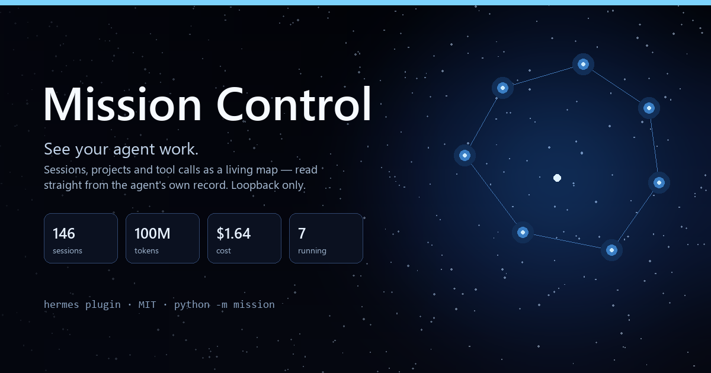
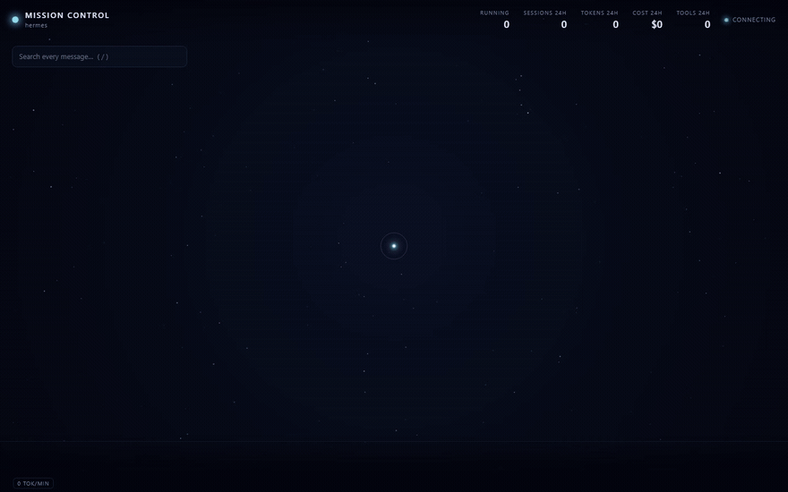
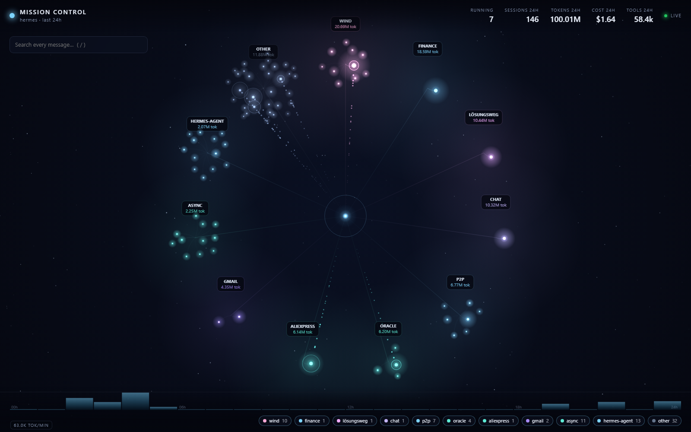
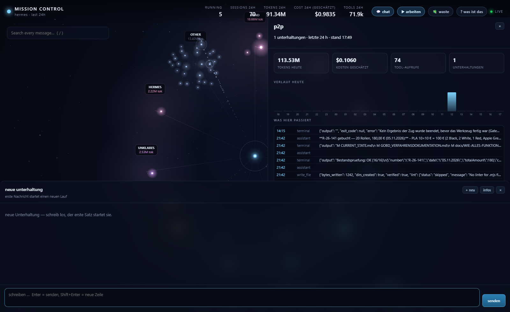
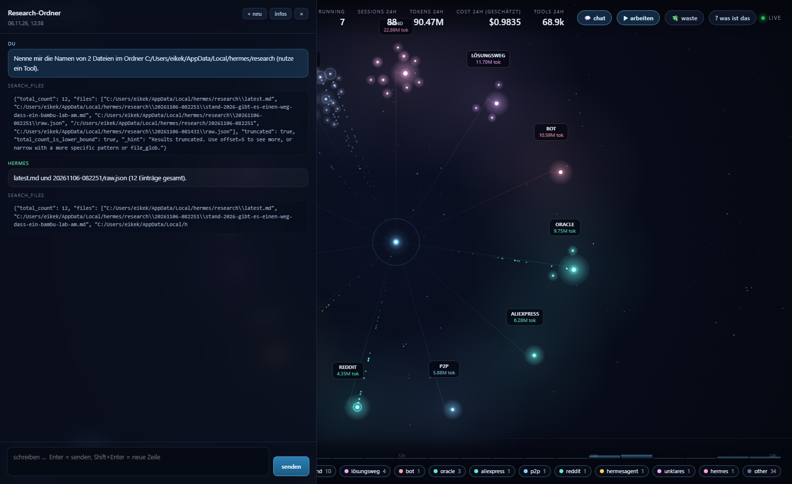
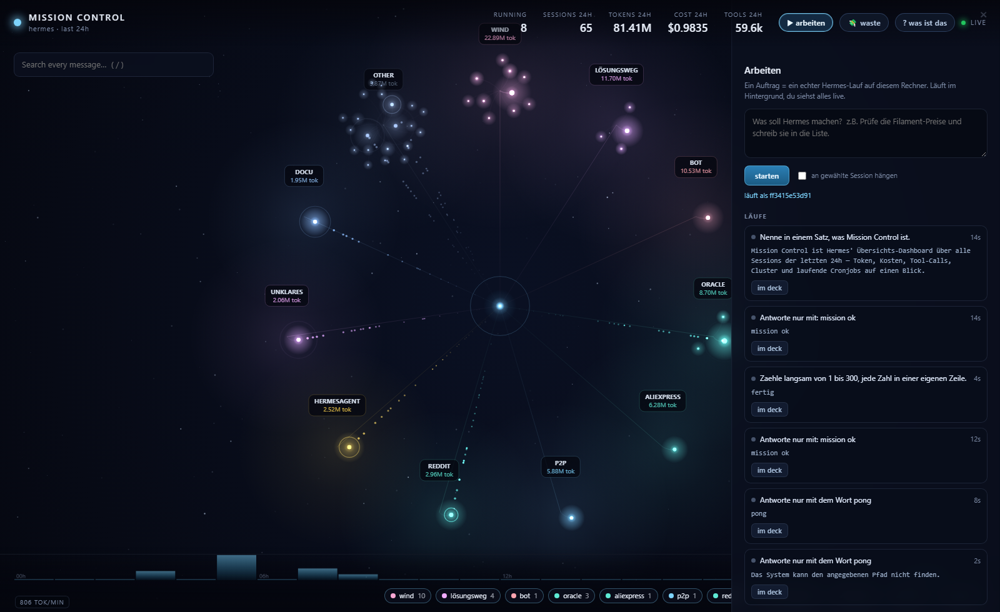
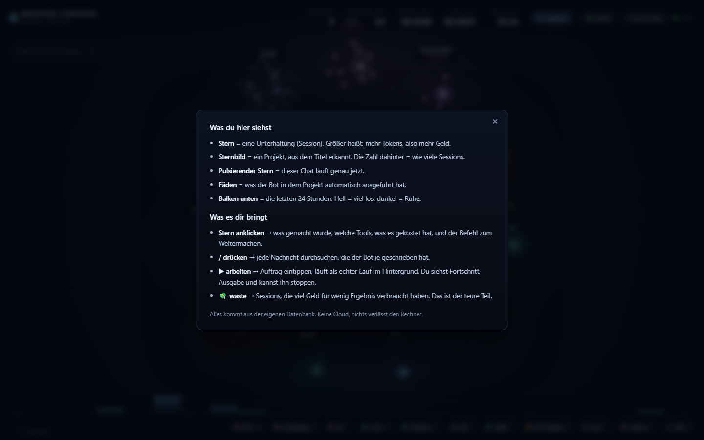
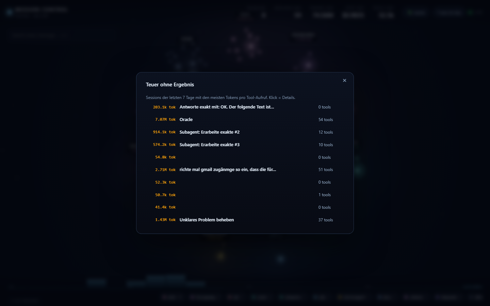

# Mission Control

<p align="center"></p>

**See your agent work.** A live, zoomable map of everything Hermes is doing — sessions become
stars, projects become constellations, tool calls become filaments. Not a log viewer: a place you
can leave open on a second screen and understand at a glance.



<sub>Recorded on a real profile: 151 sessions, 101M tokens, 9 sessions running at the same time.</sub>



## Why

An agent that runs hundreds of sessions a day is a black box. `state.db` knows everything — tokens,
tools, costs, which project a session belonged to, what was said — but reading it means writing SQL.

Mission Control reads that database (read-only) and turns it into a picture:

* **Running sessions pulse**, with particles streaming back into the core.
* **Projects cluster by topic**, sized by tokens burned in the window.
* **Click any star**: tokens, cost, top tools, last messages.
* **Press `/`**: full-text search over every message the agent ever wrote.
* **Watch the day replay** in the 24-hour histogram at the bottom.

Zero configuration. It uses the profile it runs in, so it is instantly your data.

## Was es dir bringt

Nicht nur hübsch: jede Frage, die man sich beim Arbeiten stellt, ist ein Klick.

- **? was ist das** — erklärt auf Deutsch, was Stern, Sternbild, Puls, Fäden und Balken bedeuten. Kein Fachchinesisch.
- **Stern anklicken** — zeigt die eigentliche Aufgabe der Session, was sie gekostet hat, wie viele Tokens pro Minute, die meistgenutzten Tools und den Befehl zum Weitermachen (`hermes --resume <id>`).
- **Projekt anklicken** (Sternbild-Namen im Universum) → Projekt-Ansicht: Tokens heute, Kosten, Tool-Aufrufe, Stundenverlauf als Balken, was dort gerade passiert (Live-Ereignisse), alle Unterhaltungen und die meistgenutzten Tools. Unterhaltung anklicken → Chat geht auf.
- **💬 chat** — der eigentliche Grund, warum der Chat-Tab zu darf: Stern anklicken oder `C` drücken, tippen, Enter — der Lauf startet auf deinem Rechner, die Antwort wächst live in der Blase, Tool-Aufrufe erscheinen als Chips, `stop` bricht ab, `infos` zeigt Kosten und Tools. `+ neu` startet eine frische Session.
- **▶ arbeiten** — hier wird nicht nur geschaut, sondern gearbeitet: Auftrag eintippen → startet einen **echten** Hermes-Lauf auf deinem Rechner (optional an die gewählte Session gehängt). Du siehst Laufzeit, Live-Ausgabe, den Live-Feed aller Tool-Aufrufe im System und kannst jeden Lauf mit einem Klick stoppen oder im Deck öffnen.
- **💸 waste** — Sessions der letzten 7 Tage mit den meisten Tokens pro Tool-Aufruf. Genau da verbrennt Geld.
- **Suche (/)** — jede Nachricht, die je geschrieben wurde, in Millisekunden gefunden.
- **Hover über einen Stern** — Tokens, Kosten, Tools, tok/min ohne Klick.







## Install

```bash
hermes plugins install EikeAhlers/hermes-agent-mission --enable
```

The deck starts on the first session and stays up at **http://127.0.0.1:7337** — no port forwarding,
loopback only. Ask Hermes to `mission_open` if you want it in the browser right away.

Standalone (no Hermes needed for the UI, it only reads the profile):

```bash
python -m mission --port 7337        # opens the browser
python -m mission --snapshot         # text summary, good for ssh
```

## Tools

| Tool | What it does |
|---|---|
| `mission_open` | Start the deck, return the URL and a live summary |
| `mission_snapshot` | Text numbers: sessions, tokens, cost, top burners, cron jobs |
| `mission_search` | Search every stored message, returns session ids + snippets |
| `mission_waste` | Sessions with the most tokens per tool call (last 7 days) |

Because they return text, the agent can answer "what did I do yesterday?" or "where did we discuss
the wind atlas?" from its own history — no embeddings, no vector store, just the record it already has.

## What it reads

| Source | Use |
|---|---|
| `state.db` → `sessions` | title, source, model, tokens, cost, timing, parent |
| `state.db` → `messages` | tool names, message text for search |
| `cron/jobs.json` | scheduled jobs and their state |

Everything is opened `mode=ro`. The deck never writes to the profile and never leaves loopback:
the HTTP server binds `127.0.0.1` and has no auth because it is not reachable from the network.

## Design notes

* **Topic clusters, not directories** — the agent's cwd is almost always the home directory, so the
  grouping comes from the session title ("wind · Stand …" → `wind`). Subagent sessions inherit the
  cluster of their parent, so a fan-out of 45 subagents does not turn into 45 lone stars.
* **One canvas, hand-rolled** — no chart library, no build step, no CDN. The whole front end is
  three files served by the same 160-line stdlib server.
* **Numbers are parsed, not claimed** — tokens, costs and tool counts come from the session row;
  the tool list is counted from the message rows, because the session counter only counts turns.

## Files

```
plugin.yaml            manifest (4 tools, 1 hook)
__init__.py            register(): tools + start on session
schemas.py             strict JSON schemas
mission/
  store.py             read-only queries: snapshot, clusters, detail, search, waste
  server.py            loopback HTTP + SSE, stdlib only
  tools.py             tool handlers
  web/                 index.html · style.css · app.js (canvas, no deps)
tests/                 6 tests against a synthetic profile
```

## Limits

* One profile at a time — the deck shows the profile it was loaded in.
* The 24-hour window is a fixed choice for now; `mission_snapshot` takes `hours` up to 168.
* Sessions older than the window are only reachable through search.
* Tool counts come from stored messages, so a very large session takes a moment on first paint.

## License

MIT
